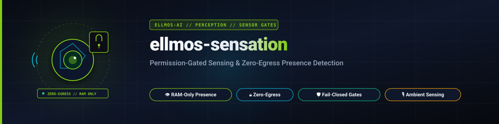

<p align="center">
  
</p>

# ellmos-sensation

**English** | [Deutsch](README_de.md)

Permission-gated device sensing for the ellmos ecosystem (BACH, Open Ocean): camera presence ("is the user at the PC?"), microphone ambient level, short sound cues, and a presence gate that tells `open-compute` when to pause desktop automation. A small, dependency-free Python package built around explicit, fail-closed permissions.

> **Status: early (v0.1.0).** This package defines the permission model, the data types, the gate logic and a sound-cue generator. It does **not** capture camera frames or microphone audio itself. Presence and ambient values come from detector and sampler callables you inject; without them the sensors return **fixed placeholder values** (presence: user present, 1 person, confidence 0.92; ambient: 34.5 dB, no speech). Do not treat default output as a real measurement.

## What it does

- **`SensationPermissions`**: three flags. `camera` and `microphone` default to `False`, `sound_output` defaults to `True`. A sensor called without its permission raises `PermissionError`.
- **`CameraPresenceSensor`**: `check_presence(permissions)` returns a `PresenceObservation` (`user_present_at_pc`, `person_count`, `confidence`, `source`, `zero_egress_ram_only`, `observed_at`). Pass `detector=` (a callable returning `(present, count, confidence)`) to plug in a real detector.
- **`MicrophoneAmbientSensor`**: `sample_ambient(permissions)` returns an `AmbientObservation` (`ambient_db`, `speech_detected`, `noise_floor_state` = `quiet` below 40 dB, `moderate` below 65 dB, otherwise `loud`). Pass `sampler=` (a callable returning `(db, speech)`) for real input.
- **`SoundSynthesizer`**: `synthesize_cue_wav(name, permissions)` generates a short 16 kHz mono WAV sine tone with a smooth envelope. Cues: `chime`, `focus_pulse`, `alert_soft`, `listening_ready`. Requires `sound_output`.
- **`OpenComputePresenceGate`**: `evaluate(permissions, idle_seconds=...)` returns `should_pause_open_compute`.
  - With camera permission: pause if the camera check reports the user present.
  - Without camera permission: pause while the last input is less than 120 seconds old (`min_idle_seconds_when_camera_off`).
- **`SensationHub`**: facade holding permissions, sensors, synthesizer and the gate; `set_permissions(...)` and `status()`.

"Zero-egress" is a design property of the data types (the observation carries a RAM-only flag and nothing is sent anywhere by this package); it is not enforced by the OS.

## Installation

Requires Python 3.10 or newer; there are no runtime dependencies. From a clone:

```bash
pip install -e .
pip install -e ".[dev]"   # pytest
```

## Usage

```bash
ellmos-sensation status
ellmos-sensation presence --allow-camera
ellmos-sensation open-compute-gate --idle-seconds 300
```

```python
from ellmos_sensation import SensationHub, SensationPermissions, CameraPresenceSensor

hub = SensationHub(
    SensationPermissions(camera=True),
    camera=CameraPresenceSensor(detector=lambda: (False, 0, 0.9)),  # your detector
)
print(hub.open_compute_gate.evaluate(hub.permissions)["should_pause_open_compute"])  # False
```

Tests live in `tests/test_sensation_hub.py` (run with `pytest`).

## Relation to ellmos and Open Ocean

`ellmos-sensation` is one of the extension modules listed in the [Open Ocean](https://github.com/ellmos-ai/open-ocean) module map. Its gate is meant to protect a user who is working at the machine from [open-compute](https://github.com/ellmos-ai/open-compute) automation; the integration on the open-compute side is not part of this repository. Module metadata is in `ellmos-module.v2.json`.

## License

MIT, as declared in `pyproject.toml`.
