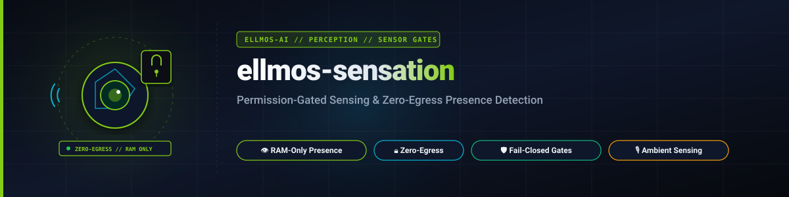

<p align="center">
  
</p>

# ellmos-sensation

[English](README.md) | **Deutsch**

Berechtigungsgesteuerte Gerätesensorik für das ellmos-Ökosystem (BACH, Open Ocean): Kamera-Präsenz („sitzt der Nutzer am PC?"), Mikrofon-Umgebungspegel, kurze Klangsignale und ein Präsenz-Gate, das `open-compute` mitteilt, wann die Desktop-Automation pausieren soll. Ein kleines, abhängigkeitsfreies Python-Paket um ausdrückliche, fail-closed Berechtigungen.

> **Status: early (v0.1.0).** Das Paket definiert das Berechtigungsmodell, die Datentypen, die Gate-Logik und einen Klangsignal-Generator. Es nimmt **selbst keine Kamerabilder und kein Mikrofonsignal auf.** Präsenz- und Pegelwerte kommen aus Detektor- und Sampler-Funktionen, die du übergibst; ohne sie liefern die Sensoren **feste Platzhalterwerte** (Präsenz: Nutzer anwesend, 1 Person, Konfidenz 0,92; Pegel: 34,5 dB, keine Sprache). Die Standardausgabe ist keine echte Messung.

## Funktionen

- **`SensationPermissions`**: drei Schalter. `camera` und `microphone` stehen standardmäßig auf `False`, `sound_output` auf `True`. Ein Sensor ohne seine Berechtigung löst `PermissionError` aus.
- **`CameraPresenceSensor`**: `check_presence(permissions)` liefert eine `PresenceObservation` (`user_present_at_pc`, `person_count`, `confidence`, `source`, `zero_egress_ram_only`, `observed_at`). Mit `detector=` (Funktion mit Rückgabe `(anwesend, anzahl, konfidenz)`) lässt sich ein echter Detektor einhängen.
- **`MicrophoneAmbientSensor`**: `sample_ambient(permissions)` liefert eine `AmbientObservation` (`ambient_db`, `speech_detected`, `noise_floor_state` = `quiet` unter 40 dB, `moderate` unter 65 dB, sonst `loud`). Mit `sampler=` (Funktion mit Rückgabe `(db, sprache)`) lässt sich echte Eingabe anbinden.
- **`SoundSynthesizer`**: `synthesize_cue_wav(name, permissions)` erzeugt einen kurzen 16-kHz-Mono-WAV-Sinuston mit weicher Hüllkurve. Signale: `chime`, `focus_pulse`, `alert_soft`, `listening_ready`. Benötigt `sound_output`.
- **`OpenComputePresenceGate`**: `evaluate(permissions, idle_seconds=...)` liefert `should_pause_open_compute`.
  - Mit Kamera-Berechtigung: Pause, wenn die Kameraprüfung den Nutzer als anwesend meldet.
  - Ohne Kamera-Berechtigung: Pause, solange die letzte Eingabe weniger als 120 Sekunden zurückliegt (`min_idle_seconds_when_camera_off`).
- **`SensationHub`**: Fassade mit Berechtigungen, Sensoren, Synthesizer und Gate; `set_permissions(...)` und `status()`.

„Zero-Egress" ist eine Entwurfseigenschaft der Datentypen (die Beobachtung trägt ein RAM-only-Flag, und dieses Paket sendet nichts irgendwohin); das Betriebssystem erzwingt es nicht.

## Installation

Benötigt Python 3.10 oder neuer; es gibt keine Laufzeitabhängigkeiten. Aus einem Klon:

```bash
pip install -e .
pip install -e ".[dev]"   # pytest
```

## Nutzung

```bash
ellmos-sensation status
ellmos-sensation presence --allow-camera
ellmos-sensation open-compute-gate --idle-seconds 300
```

```python
from ellmos_sensation import SensationHub, SensationPermissions, CameraPresenceSensor

hub = SensationHub(
    SensationPermissions(camera=True),
    camera=CameraPresenceSensor(detector=lambda: (False, 0, 0.9)),  # dein Detektor
)
print(hub.open_compute_gate.evaluate(hub.permissions)["should_pause_open_compute"])  # False
```

Die Tests liegen in `tests/test_sensation_hub.py` und `tests/test_metadata.py` (Aufruf mit `pytest`, `ruff check .` und `ruff format --check .`).

## Bezug zu ellmos und Open Ocean

`ellmos-sensation` gehört zu den Erweiterungsmodulen in der Modulzuordnung von [Open Ocean](https://github.com/ellmos-ai/open-ocean). Das Gate soll einen am Rechner arbeitenden Nutzer vor der Automation durch [open-compute](https://github.com/ellmos-ai/open-compute) schützen; die Anbindung auf der open-compute-Seite ist nicht Teil dieses Repositories. Die Modul-Metadaten stehen in `ellmos-module.v2.json`.

## Sicherheit & Governance

- [Sicherheitsrichtlinie](SECURITY.md) — Fail-Closed-Berechtigungen, Zero-Egress-RAM-Only-Grenzen und Meldewege (`48h` / `5d` / `30d` SLAs)
- [Beitragsrichtlinie](CONTRIBUTING.md) — lokaler Prüf-Workflow und Pull-Request-Regeln
- [Verhaltenskodex](CODE_OF_CONDUCT.md) — zweisprachige Community-Standards
- [Änderungsprotokoll](CHANGELOG.md) — Versionshistorie nach Keep a Changelog
- [Drittanbieter-Lizenzen & SBOM](THIRD_PARTY_LICENSES.md) — keine externen Laufzeitabhängigkeiten

## Lizenz

[MIT](LICENSE), wie in `pyproject.toml` angegeben.
